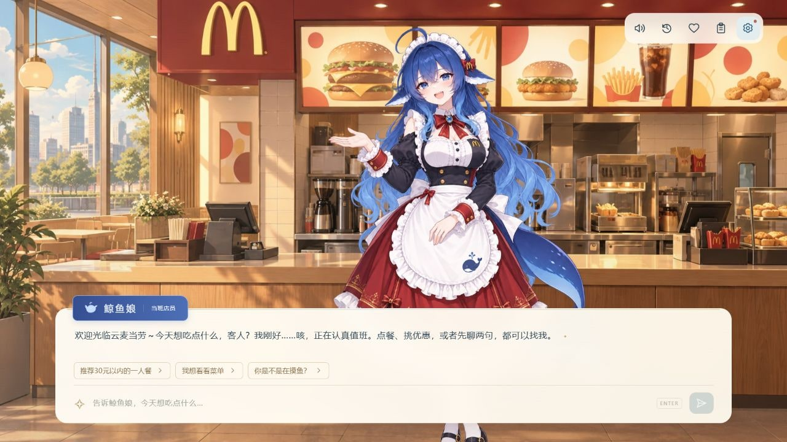
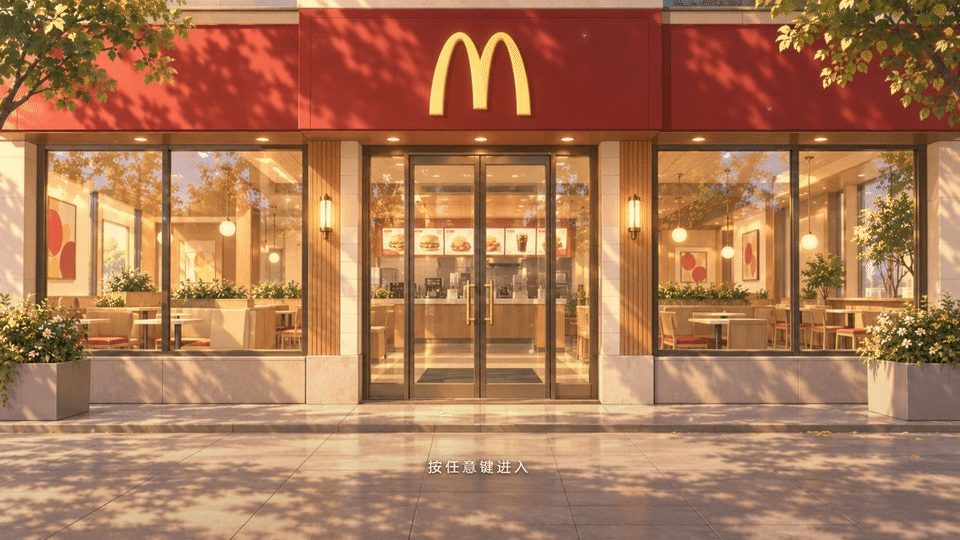
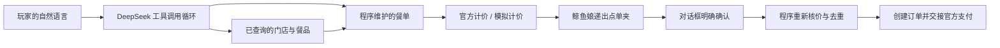

<div align="center">

# Mgo · 鲸鱼娘的云麦当劳

**推开云麦当劳的门，和正在认真值班的鲸鱼娘，点一份刚刚好的快乐。**

DeepSeek Agent × 麦当劳官方 MCP × 网页 Galgame

[快速开始](#快速开始) · [真实 MCP 集成](MCP_INTEGRATION.md) · [素材与提示词](art/ASSETS.md) · [参赛说明](CONTEST_DECLARATION.md)



</div>

Mgo 是一个以对话点餐为核心的开源网页小游戏。你是走进云麦当劳的客人，蓝发鲸鱼娘是当班店员：可以闲聊、按预算选餐、换套餐小食和饮料、查询优惠券。她会把餐品和价格写进红色点单夹，递给你看，再等你在对话框说出 **「确认下单」**。

角色设定为 **18 岁成年少女**，使用用户选定的红黑白主题女仆制服。首版有六种表情、递点单夹动作、轻微呼吸动画、点击反馈、打字效果和可关闭的少女拟声；电脑优先，手机可完整操作。暂不包含剧情章节、恋爱养成和完整语音台词。

首次打开会停在暖阳下的麦当劳门口，暖金色浮光缓缓漂过。**按任意普通按键或点击画面进入，手机可轻触屏幕**；镜头向玻璃门推进，经过暖光后来到柜台。同一标签页只播放一次开场，刷新直接回到柜台；启用系统“减少动态效果”时浮光静止，并采用简短淡入。标签页保存入店标志和声音开关，公开版对话与 Key 仍随刷新清空。

声音、对话记录、口味偏好、点单夹和设置统一排列在右上角。点单夹图标可随时展开或收起餐单，并显示已选餐品数量；名牌使用与鲸鱼娘头发呼应的蓝色系。

声音默认开启，入店手势解锁后播放跟随文字的原创合成元音，使用已选定的轻盈电子少女音色。标点和处理进度保持安静，跳过台词、静音或切到后台会停止当前拟声；刷新后若浏览器要求交互，首次操作只恢复之后的新字。试听及生成方式见 [声音说明](docs/audio/README.md)。七套立绘的双手已逐一检查，局部修复与原图对照见 [手部对照](docs/screenshots/hand-fix-comparison.jpg)。

面向希望体验对话点餐的玩家、麦当劳 MCP 开发者，以及研究“模型自主规划＋程序执行订单规则”的开发者。本项目为非官方社区创作，不代表麦当劳或 DeepSeek 官方。

## 两种运行方式

| | 公开云端体验 `demo` | 个人自部署 `live` |
|---|---|---|
| AI 对话 | 游客临时填写自己的 DeepSeek Key | 服务端环境变量配置 |
| 菜单、门店、优惠、价格 | 明确标记的模拟数据 | 麦当劳 MCP 实时查询 |
| 订单 | 仅模拟，不扣款、不配送 | 用户确认后创建真实订单 |
| 支付 | 不提供真实支付入口 | 返回麦当劳官方支付链接 |
| 会话 | 当前页面内存，刷新后重开 | 本地 SQLite 数据卷，可恢复 |

公开版会将 Key 经本站服务端发送给 DeepSeek；Key 仅存在当前页面内存和处理请求所需的内存，不写入浏览器持久存储、数据库或应用日志，模型费用由该 Key 的账户承担。自部署使用自己的环境变量，设置页只提供配置指引。Vercel 上强制使用 `demo`，即使意外设置 `APP_MODE=live` 也不会开放真实点餐。

## 快速开始

需要 **Node.js 24**。安装依赖后运行：

```bash
npm ci
cp .env.example .env.local
npm run dev
```

Windows PowerShell 将复制命令替换为：

```powershell
Copy-Item .env.example .env.local
```

打开终端输出的本地地址（默认 [http://127.0.0.1:3000](http://127.0.0.1:3000)）。默认 `demo`，场景无需密钥就能打开；点击设置，临时填入 DeepSeek Key 后开始聊天。

### 开启个人真实点餐

在本地 `.env.local` 中配置，然后重启应用：

```dotenv
APP_MODE=live
DEEPSEEK_API_KEY=你的本地密钥
DEEPSEEK_MODEL=deepseek-flash
MCD_MCP_TOKEN=你的本地令牌
MGO_DATA_DIR=.data
```

从 [DeepSeek 开放平台](https://platform.deepseek.com/api_keys) 获取模型 Key，在 [麦当劳 MCP 平台](https://open.mcd.cn/mcp) 获取自己账户的 Token。真实点餐面向中国大陆地区；价格、供应和配送范围以官方实时结果为准。

请将凭据留在自己的本地环境文件中；示例配置仅供说明，应用不会自动把 `mcp-config.example.json` 中的占位符当真实 Token 使用。

### Docker 自部署

```bash
cp .env.example .env
# 编辑 .env，设置 APP_MODE=live 并填入两项凭据
docker compose up --build -d
```

打开 [http://127.0.0.1:3000](http://127.0.0.1:3000)。Compose 默认只映射到本机。`mgo-data` 数据卷保存会话与订单提交记录，镜像使用非 root 用户运行，环境文件不会进入镜像。需要对外提供个人服务时，应自行配置 HTTPS 与访问控制；本版本不提供多人账号系统。

## 可以这样聊

> 我在上海人民广场，想自取，帮我找一家餐厅。
>
> 30 元左右的一人餐，饮料要无糖的。
>
> 把套餐里的薯条换成玉米杯，其他不变。
>
> 我有哪些能用的优惠券？
>
> 给我看看点单夹。
>
> 确认下单

真实创建订单后，使用返回的官方入口付款，再问「看看订单进度」。任何餐品或费用变化都会要求重新确认。对话中的「好的」不触发下单。

本机口味偏好由玩家主动保存，只包含预设口味和预算，支持清除；本轮明确要求优先于已保存偏好。地址、电话和凭据不进入偏好记录。



实测截图见 [门口开始界面](docs/screenshots/entrance.jpg)、[手机门口](docs/screenshots/entrance-mobile.jpg)、[桌面点单夹](docs/screenshots/order-sheet.jpg)、[手机柜台](docs/screenshots/mobile.jpg)、[思考等待状态](docs/screenshots/thinking.jpg)。

## Agent 怎样工作



模型负责自主查询、理解、追问、推荐与角色表达；程序维护 `OrderDraft`、`Quote` 和 `OrderAttempt`，校验餐品与选项来源。模型没有 `create_order` 工具。最终确认由程序识别并绑定当前报价，写入本地提交记录后才发送订单，避免重复点击或断线重试造成重复下单。

单轮最多 8 次模型请求、16 次工具调用、120 秒；查询至多自动重试一次，写入不盲目重试。提交响应丢失时显示“待核实”，不会将其当成确定失败重新下单。积分商城、抽奖、会员随单购和自动领券未开放。

## 开发与验证

```bash
npm run typecheck
npm test
npm run build
```

配置本地凭据后可显式执行：

```bash
npm run test:live
```

这组联调只读取真实 MCP 的门店、菜单、详情和计价，并用真实 DeepSeek 操作模拟订单；**不会自动创建真实麦当劳订单**。真实创建与付款请通过界面中的点单夹确认流程自行验收。另可运行 `node scripts/probe.mjs` 进行脱敏的连接检查。

技术栈：Next.js、React、TypeScript、Node.js 24、官方 MCP TypeScript Client、Zod、AJV、SQLite、Vitest。接口为 `GET /api/config`、`POST /api/chat`（SSE）和 `GET /api/session`。

## 开源与参赛

代码使用 [MIT License](LICENSE)。AI 生成素材、参考来源、完整提示词和文件清单见 [素材说明](art/ASSETS.md)；商标及第三方参考素材的权利不因代码许可而发生转移。

本项目为麦当劳程序员创意开发大赛主赛作品，不申报 WorkBuddy 专项奖励。官方声明按原文保留，报名内容见 [参赛申请草稿](docs/CONTEST_SUBMISSION.txt)，报名由仓库所有者提交。

感谢 [鲸鱼娘社区参考库](https://github.com/TreapGoGo/deepseek-whale-girl)、[麦当劳 MCP](https://github.com/M-China/mcd-mcp-server) 与所有认真吃饭、偶尔摸鱼的客人。
