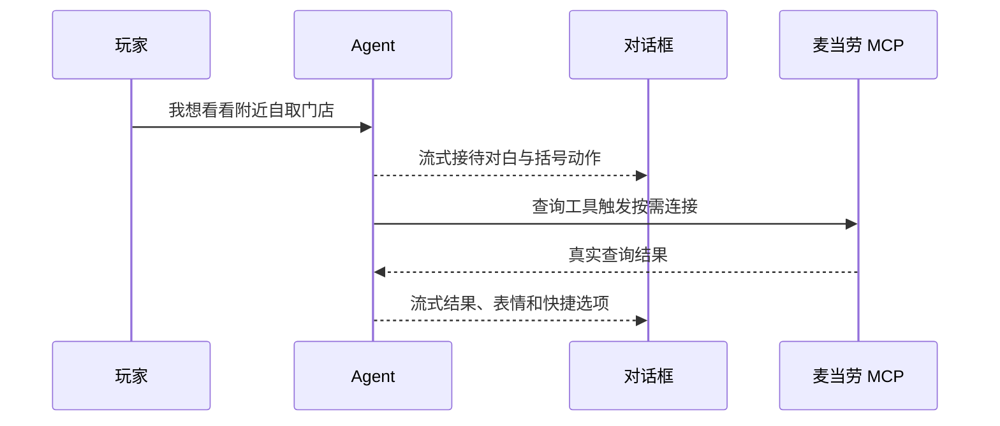

# 流式对白与点餐工具

同一个 Agent 使用本地定义的业务工具规划点餐；准备工具列表不访问麦当劳。闲聊直接生成 `reply_to_guest`，首次实时查询或核价前先生成 `narrate_to_guest`，再调用相应业务工具。过程台词与查询可以在同一次模型回复内生成。若缺少有效的过程台词，程序返回 `PROCESS_REPLY_REQUIRED`，让 Agent 补齐后继续，尚不发出 MCP 请求。

DeepSeek 开启 `stream: true`，关闭思考模式，按 `tool_calls[].index` 合并分片。专用增量解码器只读取两个对白工具的顶层 `text` 字符串，处理 JSON 转义、Unicode 及跨分片字符，不展示工具参数、字段名或推理内容。完整参数通过校验后才执行业务工具。过程台词每条最多 80 字、每轮最多三条；最终台词保留原有长度和结构校验。

## SSE 事件

接口路径仍为 `POST /api/chat`，新增事件如下：

| 事件 | 字段与作用 |
|---|---|
| `utterance_start` | `utteranceId`、`phase: progress/final`、`expression`，开始一段台词 |
| `utterance_delta` | `utteranceId`、`text`，追加已经解码的文字 |
| `utterance_end` | `utteranceId`、完整 `reply: AgentReply`；可带 `interrupted: true` |

原有 `state`、`reply`、`error`、`done` 保留，最终 `reply` 可携带对应 `utteranceId`。客户端按 ID 合并结束及兼容事件，只展示、记录和播放一次；旧客户端仍可消费最终 `reply`。欢迎语、重开和程序确认分支可直接消费原有完整回复。

文字不再等待 SSE 结束。输入及快捷操作仍等待 `done` 后启用，此时服务端已释放会话锁。点单夹仅读取 `state`；涉及取餐方式和确认提示的程序守卫先校验、必要时改写，再显示对应最终文字。

## 展示与声音

本轮过程和结果在固定高度对话框中追加，内容超过高度时滚动。用户向上查看后保持其位置，新一轮恢复跟随底部。完整过程段落进入对话记录。

全角括号专用于动作描写，显示为较淡文字且不触发拟声；括号跨网络分片也保持静音。对白按实际显示的新字播放已有音色。点击对话框跳过当前已收到的文字，后续新字正常接续；不会补播被跳过的内容。开始新消息、静音、后台与卸载的音频停止规则保持。

断流保留已显示部分并标记中断，清掉未播放文字和快捷选项，不自动重发。模型历史只保留完整调用及结果，原订单确认、核价、提交去重和写入不重试规则保持。

## 连接与观测

真实 MCP 连接与已编译 Schema 按服务端凭据 SHA-256 指纹隔离，使用引用计数共享；最后一个使用者释放后空闲 60 秒关闭。失效连接不再分配给新请求，已有使用者释放后关闭。仅只读操作可自动重试一次。请求超时时即使共享初始化仍在进行，也会及时结束等待并释放稍后取得的资源。

个人模式闲聊只需 DeepSeek Key；麦当劳 Token 缺失或过期只影响实际点餐工具。设置页仍显示原有配置状态，不展示凭据。

服务端每轮输出一条 `mgo_timing` JSON，包含请求 ID、模式、首字时间、模型轮数及各轮耗时、MCP 初始化、工具名称/耗时与总耗时；不记录正文、参数、地址或凭据。耗时对比见 [PERFORMANCE.md](PERFORMANCE.md)。
